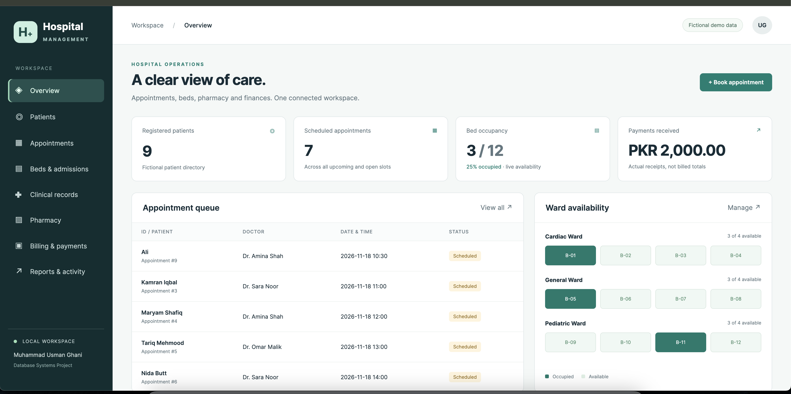
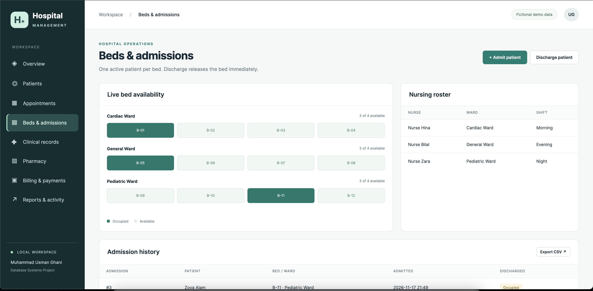
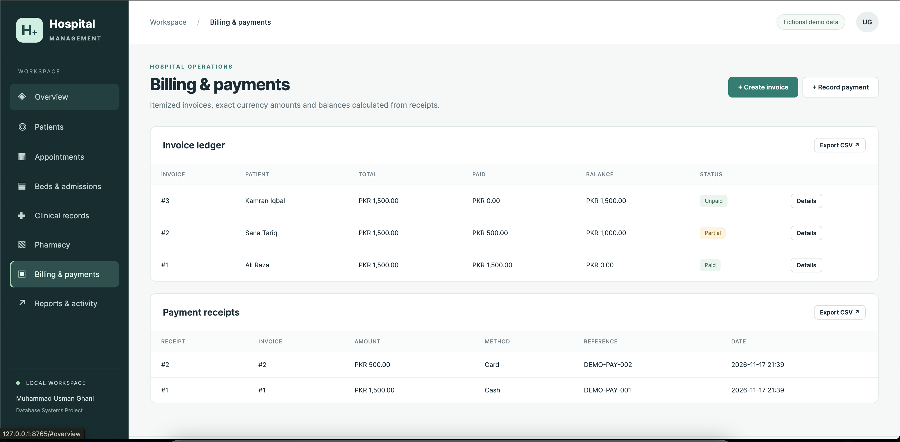

# Hospital Management

**Muhammad Usman Ghani · Database Systems project**

A local hospital-operations dashboard built with Python, SQLite and vanilla JavaScript. It connects patient registration, appointments, admissions, clinical records, pharmacy inventory and billing through a relational database.

This is an educational portfolio application with fictional data. It is not a clinical system or a medical decision tool.

## Run on your laptop

Requires Python 3.9+ with SQLite 3.31+ and a modern browser. No third-party Python packages, npm installation, MySQL server or internet connection are needed for the dashboard.

1. Extract the ZIP.
2. Open the extracted `hospital-management` folder in VS Code.
3. Open **Terminal → New Terminal**.
4. Run:

```bash
python3 main.py
```

On Windows use `py main.py`. Your browser should open automatically. If it does not, open **http://127.0.0.1:8765** while the command remains running. Stop with **Control+C** in the terminal.

The database is created and populated automatically on first launch. Later launches keep your changes. **You only need the same run command next time.** A virtual environment is optional because this project has no third-party dependencies.

See [START_HERE.md](START_HERE.md) for simple troubleshooting and [the demonstration guide](docs/demo-guide.md) for a walkthrough.

## Features

| Workspace | Working functionality |
| --- | --- |
| Overview | Appointment queue, patient totals, bed occupancy, receipts, outstanding balances and recent activity |
| Patients | Register, search and view appointment/admission/invoice history |
| Appointments | Fixed 30-minute slots, doctor and patient collision prevention, cancellation |
| Beds & admissions | Live bed map, nursing roster, admit/discharge, admission history |
| Clinical records | Complete eligible appointments as encounters and create linked prescriptions |
| Pharmacy | Receive batches, monitor expiry and usable stock, dispense prescriptions once |
| Billing & payments | Multiple invoice items, partial payments, receipt references, overpayment prevention |
| Reports | Distinct-patient counts, CSV downloads, local activity log and SQLite database backup |

## Database design

The runtime has **17 related tables, 2 reporting views and explicit indexes**. Foreign keys are enabled on every connection. Workflows use transactions so a failed operation does not leave partial invoices, stock changes or audit events.

- Money is stored as integer **PKR paisa**, avoiding floating-point rounding. The interface displays rupees.
- Invoice items and payment receipts are aggregated separately to avoid multiplying totals in joins.
- Generated-column uniqueness prevents two active admissions for a bed/patient and conflicting appointment slots.
- Doctor reports distinguish completed visits from distinct patients.
- Sample doctors, patients, contact details, medicines and transactions are fictional.

See [architecture and constraints](docs/architecture.md), [the data dictionary](docs/data-dictionary.md) and [the relationship diagram](docs/relationships.md).

## SQL coursework companion

The browser app uses **SQLite** for easy local setup. A separate **MySQL 8.0.16+** schema and fictional teaching fixture are included for database-course demonstrations; they are not connected to the dashboard.

In MySQL Workbench, execute these scripts in order against a new database:

1. `sql/schema_mysql.sql`
2. `sql/seed_mysql.sql`
3. `sql/reports.sql`

The first script creates/selects `hospital_portfolio`. Do not rerun schema or seed scripts on populated tables. The MySQL fixture has fixed dates; SQLite demo dates are generated relative to first launch. The MySQL scripts have not been executed against a live MySQL server in this delivery environment. Application-level rules require equivalent transactional service logic if you build a MySQL backend.

## Verification

```bash
python3 -m unittest discover -s tests -v
python3 main.py --check
```

The test suite contains **20 tests** covering database workflows, concurrent booking/payment attempts, rollback, CSV/backup and HTTP request boundaries. Tests use temporary databases and do not modify your saved workspace. See [validation details and limitations](docs/validation.md).

## Project files

| Path | Purpose |
| --- | --- |
| `main.py` | Local HTTP server and startup commands |
| `hospital/service.py` | Validation, transactions, workflows, queries and fictional seed data |
| `static/` | Dashboard HTML, CSS and JavaScript |
| `sql/schema_sqlite.sql` | Runtime schema and reporting views |
| `sql/schema_mysql.sql`, `sql/seed_mysql.sql` | Separate MySQL teaching companion |
| `sql/reports.sql` | Twelve read-only reporting queries |
| `tests/` | Automated integration and HTTP tests |
| `docs/` | Architecture, relationships, dictionary, walkthrough and validation |
| `runtime/` | Created locally on first run; excluded from Git |

## Scope and limitations

This is a single-computer demo with **no user accounts, roles or clinical authorization**. It listens only on `127.0.0.1`. Do not enter real patient data or expose it publicly. The local event log is not tamper-proof. Payments are recorded entries, not actual payment processing. There are no refunds, insurance claims or automatic charges for prescriptions/admissions. Doctors, departments, beds and medicine catalog entries are seeded reference data; there is no administration editor for them.

## Authorship

Original coursework: **Muhammad Usman Ghani**. This portfolio edition extends that work with AI-assisted implementation and documentation. The supplied group-labelled archive/report is not included in this rewritten edition. See [AUTHORS.md](AUTHORS.md).
## Application Screenshots

### Overview


### Beds and Admissions


### Billing and Payments
