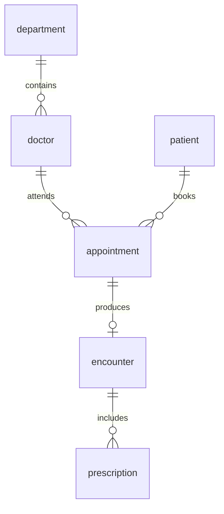
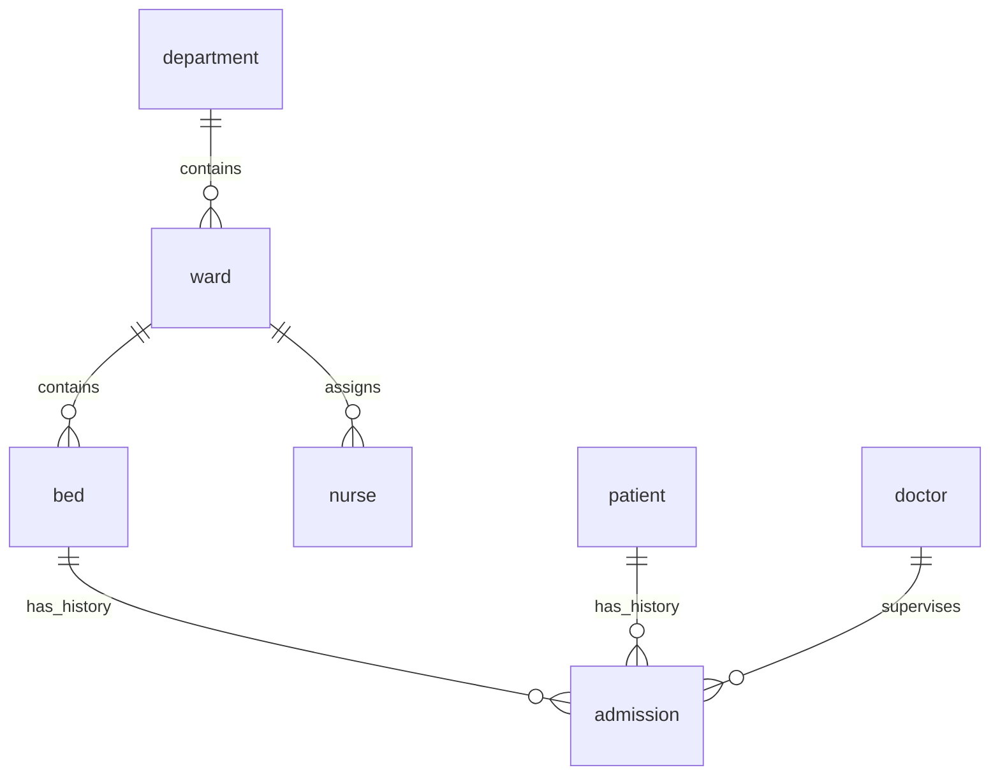
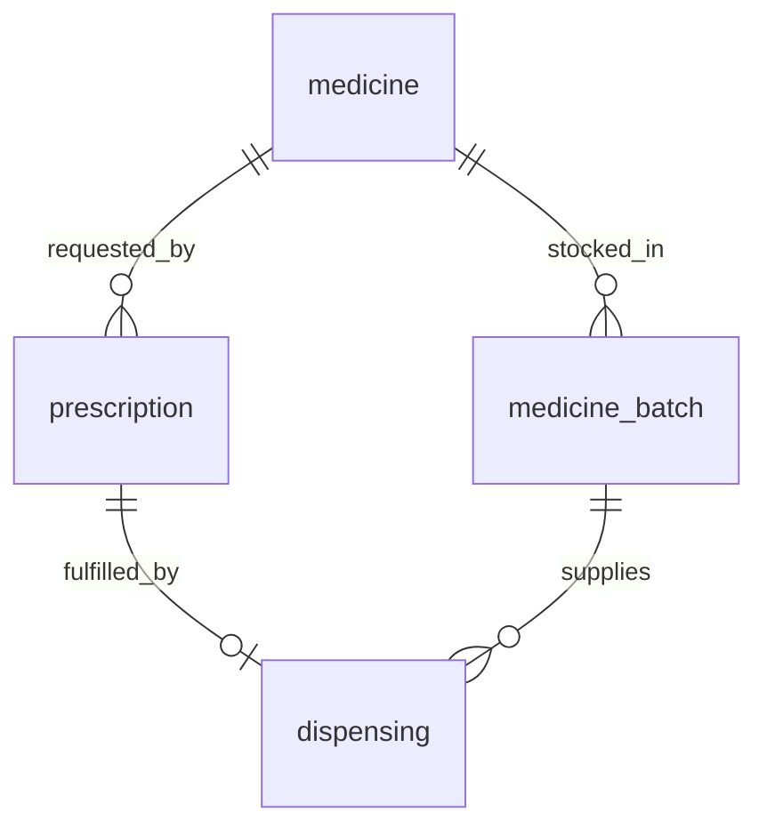
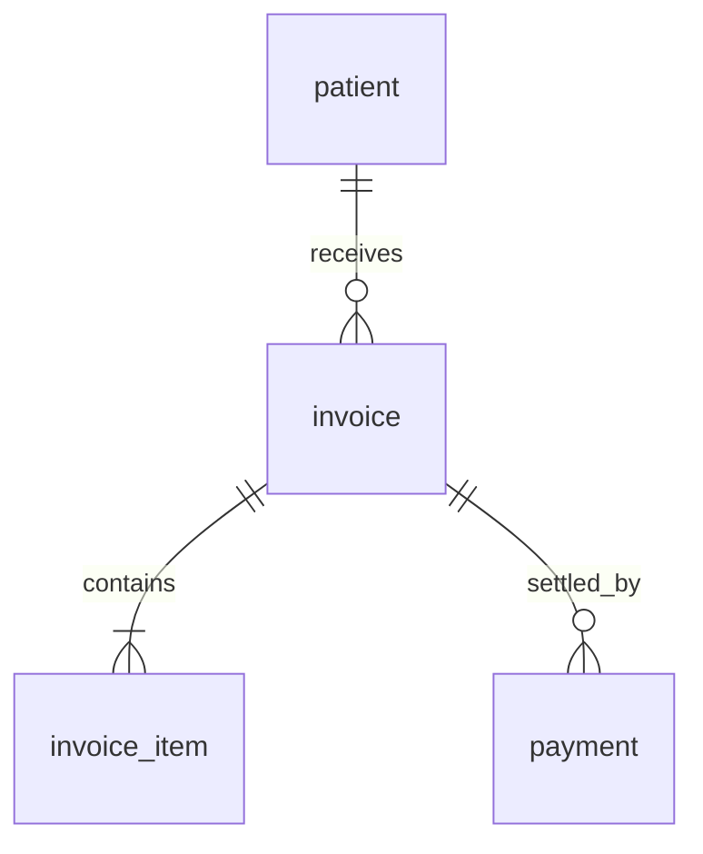

# Entity relationships

The diagrams group the schema by workflow. Entities repeated across diagrams are the same database table.

## Patient consultations

## Bed allocation

The bed/admission relation is one-to-many historically. The generated active-stay constraints limit each bed and patient to one current admission.

## Pharmacy

The service checks that the batch's medicine matches the prescription. Dispensing is a whole-prescription event, not a partial fulfillment.

## Billing

The service creates at least one invoice item atomically with its invoice. SQL foreign keys alone do not require a header to have a child. Payment status and balances are derived.

`audit_event` records application actions and IDs separately, without a foreign key to every entity type. It is not a security audit system.
